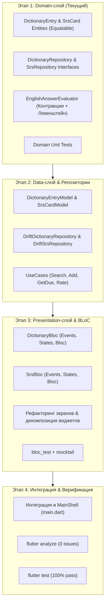

# Архитектурный план: Nexus English App (Clean Architecture)

Документ описывает поэтапный план проектирования и реализации базового каркаса приложения и ключевых модулей (**Словарь** и **SRS-тренажёр повторений**) в строгом соответствии с `AGENTS.md` и плейбуком `/flutter-clean-arch-playbook`.

---

## 1. Архитектурные решения (Design Consensus)

### 1.1. Акценты (US vs UK)
- **Сущность словаря:** `DictionaryEntry` содержит поддержку отображения IPA-транскрипции (с приоритетом под выбранный пользователем диалект в настройках) и привязку аудио.
- **Озвучка:** `HybridAudioPlaybackService` динамически переключает голос произношения (`en-US` Jenny/Guy/Samantha vs `en-GB` Sonia/Ryan/Daniel) на основе `SecureAppSettingsStorage`.

### 1.2. Проверка ввода в SRS (English Answer Evaluator)
- **Нормализация:** приведение к нижнему регистру, тримминг пробелов, удаление лишней пунктуации, унификация типографических апострофов (`’` $\to$ `'`).
- **Контракции (Short Forms):** умный словарь раскрытия сокращений (`don't` $\leftrightarrow$ `do not`, `I'm` $\leftrightarrow$ `I am`, `can't` $\leftrightarrow$ `cannot`, `it's` $\leftrightarrow$ `it is`, `won't` $\leftrightarrow$ `will not`, `they're` $\leftrightarrow$ `they are` и т.д.).
- **Толерантность к опечаткам:** вычисление расстояния Левенштейна (при длине слова $> 4$ допускается 1 опечатка со статусом `almostCorrect` — пользователь видит подсказку, но карточка не сбрасывается в грубый провал).

### 1.3. Связка модулей «Словарь» и «SRS»
- Добавление слова из Словаря создаёт карточку со статусом `newCard` в FSRS.
- В выдаче словаря отображается реактивный статус: находится ли слово в активном изучении SRS.
- Все операции проходят строго через доменные сценарии (UseCases), возвращающие `Result<T>`.

---

## 2. Поэтапный план реализации

### Этап 1: Доменный слой и валидатор ответов (Текущий)
1. Базовые ошибки `lib/core/error/failures.dart`.
2. Сущности `lib/features/dictionary/domain/entities/dictionary_entry.dart` и `lib/features/srs/domain/entities/srs_card.dart`.
3. Интерфейсы репозиториев `DictionaryRepository` и `SrsRepository` с сигнатурами `Future<Result<T>>`.
4. Сервис проверки ввода `lib/features/srs/domain/services/english_answer_evaluator.dart`.
5. Покрытие юнит-тестами доменной логики.

### Этап 2: Data-слой и сценарии использования (UseCases)
1. Модели `DictionaryEntryModel` и `SrsCardModel` с маппингом из Drift-таблиц.
2. Реализация `DriftDictionaryRepository` и `DriftSrsRepository` с FSRS-расчётом интервалов и обработкой исключений в `Result.failure`.
3. Сценарии использования: `SearchDictionaryUseCase`, `AddWordToSrsUseCase`, `GetDueCardsUseCase`, `RateSrsCardUseCase`.

### Этап 3: Presentation-слой и BLoC
1. `DictionaryBloc` (`DictionaryEvent`, `DictionaryState`).
2. `SrsBloc` (`SrsEvent`, `SrsState`).
3. Рефакторинг `DictionaryScreen` и `SrsStudyScreen` на чистый BLoC с декомпозицией вёрстки на приватные `StatelessWidget`.
4. BLoC-тесты (`bloc_test` + `mocktail`).

### Этап 4: Сборка и верификация
1. Подключение BLoC через `BlocProvider` / `RepositoryProvider` в `main.dart`.
2. Проверка статического анализатора `flutter analyze`.
3. Прогон всех тестов `flutter test`.
